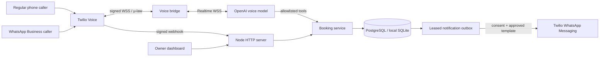

# SalonLine

A working bilingual salon receptionist project: owner dashboard, authoritative appointment calendar, English/Urdu training conversations, and a server-side Twilio ↔ OpenAI Realtime voice bridge for regular phone and WhatsApp Business calls.

**Delivery status:** the local application and automated tests run without provider accounts. Real telephone/WhatsApp calls require your credentials, approved numbers, public HTTPS hosting, and live acceptance testing. Those external services are not connected in this delivery. This is production-oriented source, not a claim of a validated production deployment.

## Start locally

Requirements: Node.js **24 or newer**, npm or pnpm. On Windows, open PowerShell in this folder and run:

```powershell
npm install
npm run setup
npm start
```

Or run `START.ps1`. In the prepared workspace, dependencies are already installed, so this launcher can start the app directly. Open **http://localhost:3000**. Setup creates a unique owner password and session secret in `.env`; sign in with `ADMIN_PASSWORD` from that file. Never put provider keys in chat or in the dashboard.

For a quick local-only preview, `node server/index.mjs` also works before running setup. It binds to `127.0.0.1`, uses SQLite, and does not require owner authentication. A password is mandatory for any non-loopback binding or live voice configuration.

## Try the complete flow

1. Open **Voice studio** and choose English or اردو.
2. Enter `haircut`, then `tomorrow` or an open date in `YYYY-MM-DD` format.
3. Select a listed time by number, enter a fictional name and an international-format phone number.
4. Review the service, stylist, date, time zone, and price. Type `confirm` or `تصدیق`.
5. Open **Appointments**. The record is saved to the real local database. View, move, or cancel it.

The studio is a **guided training simulator**, not a paid live AI call. Browser speech recognition and speech synthesis are optional browser features; support and Urdu voice availability vary by device. Demo conversations never send WhatsApp messages. Live phone calls use the Realtime model and the same booking rules.

The initial business is fictional. Its sample address/phone/prices must be replaced before launch. Its configured time zone is `Asia/Karachi`; all appointment times use the business time zone. Change the business information, services, staff, hours, and currency in **Business settings** before adding real bookings.

## Included

- Responsive owner workspace: overview, appointment search, create/move/cancel, call outcomes, training studio, business settings, and integration readiness.
- SQLite local persistence and PostgreSQL production storage.
- Atomic service-duration conflict checks and idempotency keys.
- Customer booking-code + caller-number verification for voice changes.
- Separate proposal/readback/confirmation steps; voice tools cannot change identity, price, or admin privileges.
- Independent transient transcription confirms a short English/Urdu “yes” after the readback; unclear replies require another confirmation.
- English/Urdu instructions and natural language switching on live calls.
- Signed Twilio HTTP webhooks; signed, expiring, caller-bound streaming tokens.
- Raw 8 kHz μ-law audio streaming, interruption handling and playback truncation.
- Call duration, silence, setup, concurrency, payload and backpressure limits.
- Callback tasks when the voice service fails; callbacks are staff tasks, not automatic outbound calls.
- Transactional WhatsApp notification outbox, consent, approved templates, retries, leases and delivery audit events.
- Owner sessions, request limits, same-origin mutation checks, security headers, redacted request logs and graceful shutdown.
- Docker Compose, PostgreSQL health checks, Caddy HTTPS example, tests and operations documentation.

## Enable real calls

See [docs/GO-LIVE.md](docs/GO-LIVE.md). In brief, deploy the server over HTTPS/WSS, configure the OpenAI and Twilio environment variables, register your phone/WhatsApp business numbers, and point incoming call webhooks to `/webhooks/twilio/voice`.

WhatsApp uses the **official Business Calling API**. A personal WhatsApp account is not the integration used by this project. Business verification, calling eligibility, country availability, sender enablement, and template approval are provider prerequisites. WhatsApp and regular phone calls reach the application through separate incoming channels. This project does not bridge WhatsApp callers to a regular telephone endpoint.

## Architecture



The built-in booking database is the calendar of record. There is no Google Calendar, Fresha, Booksy, or other external salon calendar sync in this version. Do not operate two independent booking calendars for the same staff. An external booking provider should replace the booking adapter before use at a business that already relies on one.

## Development and verification

```powershell
npm test
npm run check
```

Tests cover overlap races, duration-aware slots, identity checks, consent, idempotency, rollback, persistence, daylight-saving transitions, HTTP authentication, English/Urdu booking conversations, signed webhooks, streaming tokens and mocked live audio protocol behavior. The PostgreSQL integration suite can be enabled with `TEST_DATABASE_URL` pointing at a **disposable test database**; it creates and removes an isolated schema.

See [docs/VERIFICATION.md](docs/VERIFICATION.md) for delivery-time results and limitations. [docs/API.md](docs/API.md) documents the HTTP interface, and [docs/OPERATIONS.md](docs/OPERATIONS.md) covers monitoring and incident handling.

## File map

```text
public/                 Dashboard, styles and browser training UI
server/index.mjs        HTTP routing, owner sessions, guards, worker lifecycle
server/voice.mjs        Twilio/OpenAI streaming bridge
server/agent.mjs        Approved knowledge, tools and confirmation workflow
server/twilio.mjs       Signatures, TwiML and messaging client
server/store.mjs        Database transactions and outbox
server/booking.mjs      Appointment validation and time-zone rules
server/config.mjs       Configuration and sample business
server/demo.mjs         Deterministic English/Urdu training conversation
server/schema.sql       Initial database schema
test/                   Domain, HTTP and voice protocol tests
docs/                   Setup, API, operations and verification guides
```
